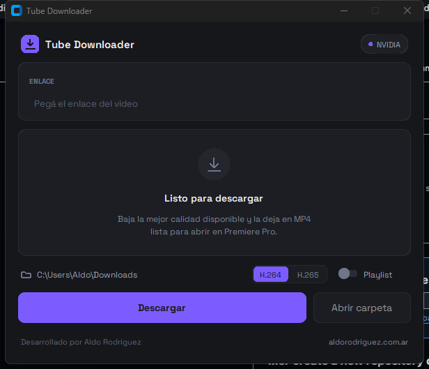
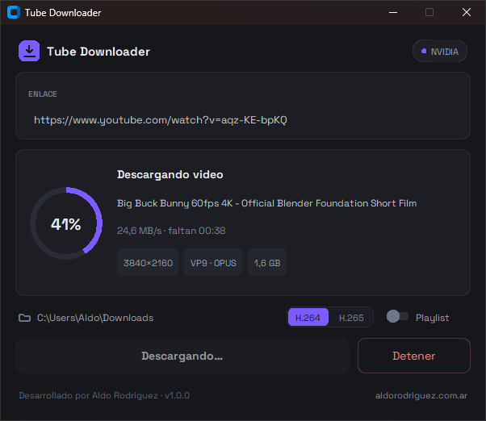
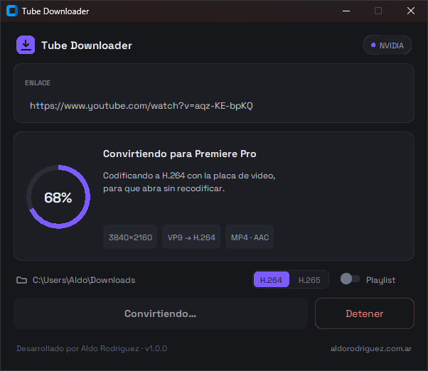
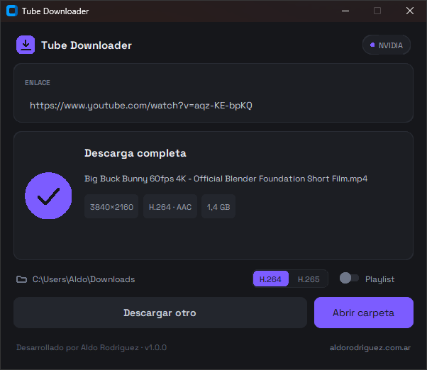
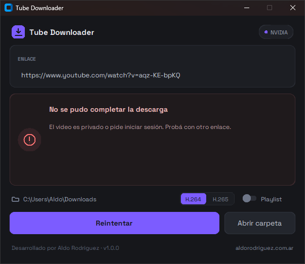
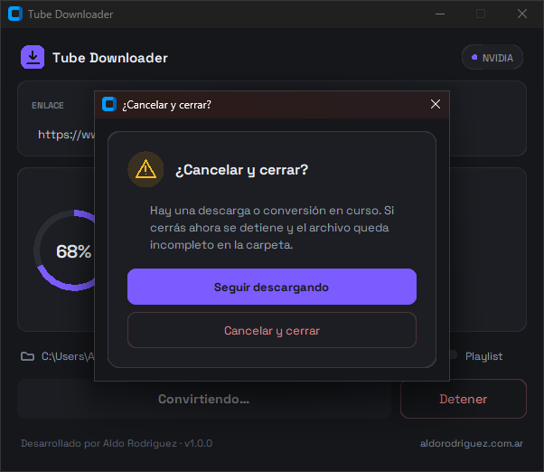
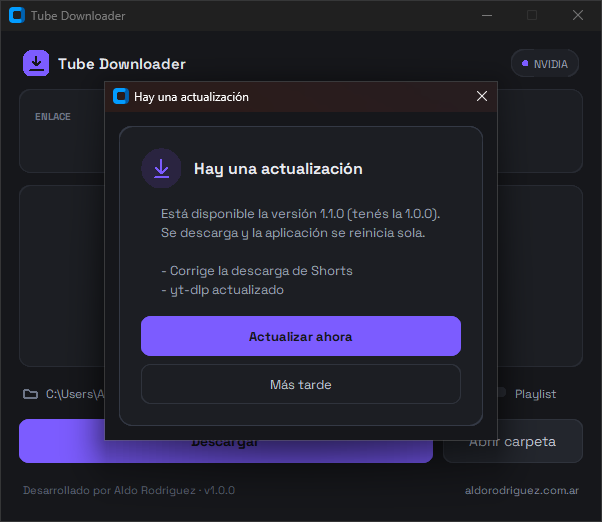
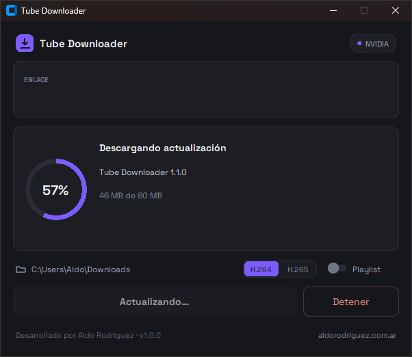

<div align="center">



# Tube Downloader

**YouTube videos in the highest quality, ready to edit in Premiere Pro.**

[🇦🇷 Español](README.md) · 🇬🇧 **English**

[](https://github.com/aldomrodriguez/tube-downloader/releases/latest)
[](https://github.com/aldomrodriguez/tube-downloader/releases)
[](#compatibility)
[](#compatibility)
[](LICENSE)

### [⬇ Download TubeDownloader.exe](https://github.com/aldomrodriguez/tube-downloader/releases/latest/download/TubeDownloader.exe)

</div>

---

> **Note:** the app's interface is currently in **Spanish** only. The screenshots below
> show it as it looks today.

## Contents

- [Why it exists](#why-it-exists)
- [What it does](#what-it-does)
- [Screenshots](#screenshots)
- [Compatibility](#compatibility)
- [Install and use](#install-and-use)
- [Updates](#updates)
- [FAQ](#faq)
- [Build from source](#build-from-source)
- [How it works](#how-it-works)
- [Contributing](#contributing)
- [License and credits](#license)

## Why it exists

Downloading a video in "best quality" and then finding it won't open in Premiere is a
common problem: YouTube publishes its best qualities in VP9 and AV1, codecs that
Premiere can't decode. The usual workaround — grabbing whatever already comes in
H.264 — costs you resolution, because above 1080p YouTube no longer offers H.264.

This tool solves both at once: it downloads the real original, and converts it to
H.264 only when needed, using your graphics card so it doesn't take long.

## What it does

| | |
|---|---|
| 🎯 **Always the best quality** | Downloads the best video and audio combination available for that link, 4K included. |
| 🎬 **Ready to edit** | The result is an MP4 that Premiere Pro opens without re-encoding. |
| ⚡ **No needless conversion** | If YouTube already offers H.264 at the video's top resolution, it's downloaded as is: instant and lossless. |
| 🖥️ **GPU-accelerated conversion** | NVIDIA, Intel or AMD, with automatic fallback to the CPU if the GPU fails. |
| 🎛️ **Pick your codec** | H.264 (most compatible for editing) or H.265 (files ~25% smaller). |
| 📃 **Playlists** | A single video or the whole list. |
| 📊 **Real progress** | Speed and time remaining, with a stop button. |
| 📦 **Everything included** | ffmpeg is bundled; nothing to install. |
| 🔄 **Updates itself** | Tells you when a new version is out and installs it in one click. |

## Screenshots

<table>
  <tr>
    <td align="center" width="50%"><br><sub><b>Home</b> · paste the link, choose a folder and a codec</sub></td>
    <td align="center" width="50%"><br><sub><b>Downloading</b> · real progress, speed and time remaining</sub></td>
  </tr>
  <tr>
    <td align="center"><br><sub><b>Converting</b> · to H.264 on the GPU, only when needed</sub></td>
    <td align="center"><br><sub><b>Done</b> · an MP4 Premiere opens without re-encoding</sub></td>
  </tr>
  <tr>
    <td align="center"><br><sub><b>Clear errors</b> · what happened and what to do, no jargon</sub></td>
    <td align="center"><br><sub><b>Safe close</b> · asks before cutting off a download</sub></td>
  </tr>
  <tr>
    <td align="center"><br><sub><b>Update available</b> · with the release notes</sub></td>
    <td align="center"><br><sub><b>Updating</b> · downloads, verifies and restarts itself</sub></td>
  </tr>
</table>

## Compatibility

| System | Status |
|---|---|
| **Windows 11** (64-bit) | ✅ Supported |
| **Windows 10** (64-bit) | ✅ Supported |
| **macOS** | 🔜 Coming soon |

| Hardware acceleration | Technology | Status |
|---|---|---|
| NVIDIA (GeForce GTX 600 or newer) | NVENC | ✅ |
| Intel (integrated graphics, 6th gen or newer) | Quick Sync | ✅ |
| AMD (Radeon RX 400 or newer) | AMF | ✅ |
| No compatible card | CPU | ✅ Slower, but works the same |

The graphics card is detected automatically on launch; the one in use is shown at the
top right.

| Video editor | Status |
|---|---|
| Adobe Premiere Pro | ✅ Opens the MP4 without re-encoding |
| DaVinci Resolve, Final Cut Pro, CapCut, Vegas | ✅ H.264 + AAC in MP4, the most compatible format |

## Install and use

64-bit Windows 10 or 11, nothing else: the `.exe` is self-contained and doesn't need
ffmpeg or Python installed.

1. Download [`TubeDownloader.exe`](https://github.com/aldomrodriguez/tube-downloader/releases/latest/download/TubeDownloader.exe)
   and save it anywhere you like (the Desktop, for example). There's no installer.
2. Open it, paste the video link, and pick a folder and a codec.
3. Click **Descargar** (Download).

The destination folder and codec are remembered for next time.

## Updates

On launch, the app checks
[Releases](https://github.com/aldomrodriguez/tube-downloader/releases) for a newer
version. If there is one, it offers to update: it downloads the new `.exe`, verifies it
matches what was published, and restarts itself already updated.

- With no internet connection it asks nothing and keeps working normally.
- It never interrupts a download in progress: it waits until it's finished.
- Updating often matters: YouTube changes frequently, and every release ships a
  current yt-dlp.

## FAQ

<details>
<summary><b>Windows says "Windows protected your PC". Is it safe?</b></summary>

That's SmartScreen, which warns about any program that hasn't been downloaded by many
people yet. Click **More info → Run anyway**. The full source code is in this
repository and you can build it yourself.
</details>

<details>
<summary><b>A video that used to download now fails.</b></summary>

Almost always because YouTube changed something. Open the app with an internet
connection so it can fetch the latest version. If you're already up to date and it
still fails, [open a report](https://github.com/aldomrodriguez/tube-downloader/issues/new/choose).
</details>

<details>
<summary><b>Why is it sometimes slow and sometimes instant?</b></summary>

If YouTube offers the video in H.264 at its top resolution (typically up to 1080p), it's
downloaded as is and there's nothing to convert. At 1440p and 4K YouTube only offers VP9
or AV1, so a conversion is needed; with a graphics card it usually takes a fraction of
the video's length.
</details>

<details>
<summary><b>H.264 or H.265?</b></summary>

H.264 if you're going to edit: every program opens it and it's lighter on the
timeline. H.265 if you want smaller files for storing or sharing.
</details>

<details>
<summary><b>Is there a Mac version?</b></summary>

Not yet, but it's on the way. To be notified when it's out, click
**Watch → Custom → Releases** at the top of this page.
</details>

<details>
<summary><b>Is there an English interface?</b></summary>

Not yet; the app is in Spanish only for now. The documentation is available in both
languages.
</details>

<details>
<summary><b>Where are the settings stored?</b></summary>

In `%APPDATA%\TubeDownloader\config.json`. Deleting it resets everything to the
defaults.
</details>

## Build from source

You need Python 3.11 or newer.

```powershell
git clone https://github.com/aldomrodriguez/tube-downloader.git
cd tube-downloader
.\build.ps1
```

The script creates the virtual environment, installs the dependencies, packages
everything with PyInstaller and leaves the executable at `dist\TubeDownloader.exe`.

To run it without packaging:

```powershell
python -m venv venv
.\venv\Scripts\python.exe -m pip install -r requirements.txt
.\venv\Scripts\python.exe app.py
```

### Publishing a new version

The full process — version number, changelog, build, release and maintenance — is in
[RELEASING.en.md](RELEASING.en.md).

### Code signing (optional)

If you have a code-signing certificate in your personal Windows certificate store,
`build.ps1` finds it by the holder's name and signs the executable automatically, with
a timestamp. If there isn't one, the build still succeeds and the `.exe` is left
unsigned.

## How it works

A few decisions that aren't obvious and are worth explaining:

**Picking a format without giving up resolution.** Formats are sorted by resolution
first and by codec only after that, preferring H.264 among ties. So a video that tops
out at 1080p is downloaded straight in H.264 with nothing to convert, while one with
real 4K downloads in 4K and pays for the conversion.

**The 4096-pixel limit.** NVENC's H.264 engine doesn't accept images larger than 4096 px
per side (measured: 4096 encodes, 4097 returns "exceeds 4096"). For larger videos it
uses GPU H.265, which goes up to 8192, instead of falling back to the CPU.

**Progress across two files.** yt-dlp downloads video and audio separately, each
reporting its own 0–100%. The app looks up the sizes beforehand and shows a single
progress bar over the real total, with the speed smoothed so the time remaining
doesn't jump around.

**Temporary file during conversion.** The downloaded file is often already an `.mp4`,
so converting straight onto its own name would make ffmpeg read and write the same file
and abort. The conversion always writes to a temporary file that then replaces the
original.

**Safe close.** ffmpeg runs as a separate process, not a Python thread: closing the
window without killing it would leave it running, locking the half-written file. When
you close with work in progress, the app asks and, if you confirm, really terminates it.

**Self-update.** Windows won't let a running `.exe` overwrite itself. The app
downloads the new version to a temporary folder, verifies its SHA-256 against the one
GitHub publishes, and leaves a small script that waits for the app to close, replaces
the file and reopens it. If the replacement fails, the previous version is left intact.

### Project layout

```
├── app.py              The application (interface and download logic)
├── updater.py          Finds, downloads and installs updates from Releases
├── build.ps1           Builds the executable and signs it if a certificate exists
├── requirements.txt    Python dependencies
├── version_info.txt    Executable metadata (filled in by build.ps1)
├── CHANGELOG.md        Changes in each version (Spanish)
├── CHANGELOG.en.md     Changes in each version (English)
├── RELEASING.md        How to publish a version (Spanish)
├── RELEASING.en.md     How to publish a version (English)
├── assets/             Space Grotesk typeface and its license
└── docs/               Screenshots
```

## Contributing

Contributions are welcome! Before you start, read the
[contributing guide](CONTRIBUTING.en.md) and the [code of conduct](CODE_OF_CONDUCT.en.md).

- 🐛 Found a bug? [Report it](https://github.com/aldomrodriguez/tube-downloader/issues/new?template=bug-report.yml).
- 💡 Have an idea? [Suggest it](https://github.com/aldomrodriguez/tube-downloader/issues/new?template=feature-request.yml).
- 🔒 Found a security problem? Follow the [security policy](SECURITY.en.md); don't post it in an issue.

Issues and pull requests can be written in English or Spanish.

## License

[GPL-3.0](LICENSE).

The executable includes an FFmpeg build compiled with `--enable-gpl
--enable-version3`, so the distributed binary is covered by GPL version 3. That's why
the project adopts the same license.

## Credits

- [yt-dlp](https://github.com/yt-dlp/yt-dlp) — download engine
- [FFmpeg](https://ffmpeg.org/) — decoding, conversion and muxing
- [CustomTkinter](https://github.com/TomSchimansky/CustomTkinter) — interface widgets
- [Space Grotesk](https://fonts.google.com/specimen/Space+Grotesk) by Florian Karsten,
  under the [SIL Open Font License](assets/SpaceGrotesk-OFL.txt)

## Responsible use

This tool is meant for downloading your own content, material under a license that
allows it, or videos whose rights authorize you to do so. Downloading copyrighted
material without permission may violate YouTube's terms of service and the laws of your
country. How you use it is your responsibility.

---

<div align="center">

Developed by **Aldo Rodriguez** — [aldorodriguez.com.ar](https://aldorodriguez.com.ar)

</div>
