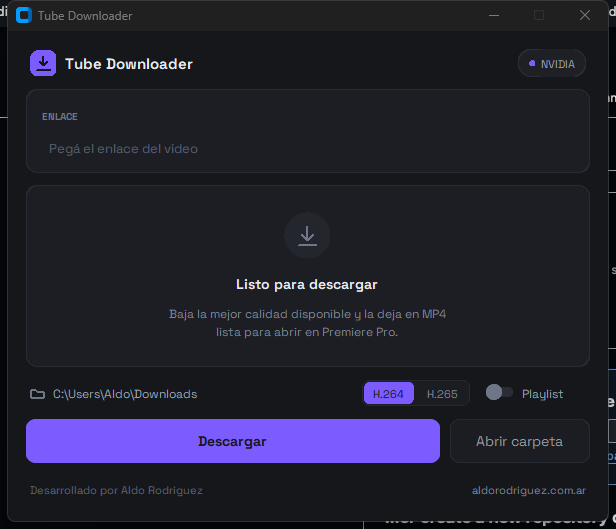
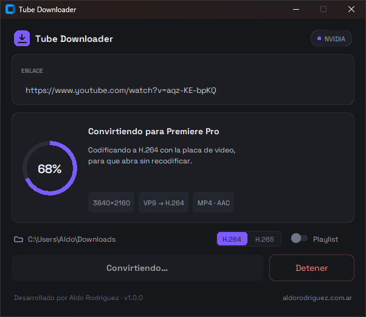

# Tube Downloader

Aplicación de escritorio para Windows que descarga videos de YouTube en la máxima
calidad disponible y los entrega en MP4 listos para editar en Premiere Pro.



## Por qué existe

Bajar un video en "máxima calidad" y que después no abra en Premiere es un problema
común: YouTube publica sus mejores calidades en VP9 y AV1, códecs que Premiere no
decodifica. La solución típica —bajar directamente lo que ya viene en H.264— tiene
el costo de quedarse en 1080p, porque arriba de esa resolución YouTube ya no ofrece
H.264.

Esta herramienta resuelve las dos cosas a la vez: baja el original real, y lo
convierte a H.264 solo cuando hace falta, usando la placa de video para que no tarde.

## Qué hace

- **Máxima calidad siempre.** Descarga la mejor combinación de video y audio que
  exista para ese link, incluido 4K.
- **Listo para editar.** El resultado es un MP4 que Premiere Pro abre sin
  recodificar.
- **No convierte al pedo.** Si YouTube ya ofrece H.264 en la resolución máxima del
  video, lo baja así y no hay conversión: es instantáneo y sin pérdida de calidad.
- **Conversión por placa de video** cuando sí hace falta, con respaldo automático al
  procesador si la GPU falla.
- **Elegís el códec**: H.264 (más compatible para editar) o H.265 (archivos ~25% más
  chicos).
- **Playlists**: podés bajar un video suelto o la lista completa.
- **Progreso real** con velocidad y tiempo restante, y botón para detener.
- **Todo incluido.** El ejecutable trae ffmpeg adentro; no hay que instalar nada.



## Requisitos

Windows 10 u 11 de 64 bits. Nada más: el `.exe` es autocontenido.

La aceleración por GPU se detecta sola. Funciona con NVIDIA (NVENC), Intel (Quick
Sync) y AMD (AMF); si no hay ninguna disponible, usa el procesador.

## Uso

Descargá `TubeDownloader.exe` desde
[Releases](../../releases) y ejecutalo. Pegás el link, elegís carpeta y códec, y le
das a Descargar.

La carpeta de destino y el códec quedan guardados para la próxima vez.

### Actualizaciones

Al abrirse, la aplicación consulta si hay una versión nueva en Releases. Si la hay,
ofrece actualizar: descarga el nuevo `.exe`, verifica que coincida con el publicado
y se reinicia sola ya actualizada. Si no hay internet, no pregunta nada y sigue
funcionando normal. Nunca interrumpe una descarga en curso.

Conviene actualizar seguido: YouTube cambia a menudo y cada versión trae un yt-dlp
al día.

## Compilar desde el código

Necesitás Python 3.11 o superior.

```powershell
git clone https://github.com/<tu-usuario>/<tu-repo>.git
cd <tu-repo>
.\build.ps1
```

El script crea el entorno virtual, instala las dependencias, empaqueta todo con
PyInstaller y deja el ejecutable en `dist\TubeDownloader.exe`.

Si querés correrlo sin empaquetar:

```powershell
python -m venv venv
.\venv\Scripts\python.exe -m pip install -r requirements.txt
.\venv\Scripts\python.exe app.py
```

### Publicar una versión nueva

1. Subí `APP_VERSION` en `app.py` (por ejemplo `"1.1.0"`). Es el único lugar donde
   está la versión: `build.ps1` la copia a los metadatos del `.exe`.
2. Compilá con `.\build.ps1`.
3. En GitHub, creá un Release con el tag `v1.1.0` y adjuntá
   `dist\TubeDownloader.exe` con ese nombre exacto. Lo que escribas en la
   descripción se muestra en el aviso de actualización.

Las instalaciones existentes lo detectan la próxima vez que se abren. Los releases
marcados como borrador o pre-release se ignoran, así que sirven para probar.

### Firma de código (opcional)

Si tenés un certificado de firma en tu almacén personal de Windows, `build.ps1` lo
detecta por el nombre del titular y firma el ejecutable automáticamente, con sellado
de tiempo. Si no hay ninguno, la compilación sigue igual y el `.exe` queda sin firmar.

## Cómo funciona

Algunas decisiones que no son obvias y valen la aclaración:

**Elegir formato sin resignar resolución.** Los formatos se ordenan primero por
resolución y recién después por códec, prefiriendo H.264 entre los que empatan. Así
un video que topea en 1080p se baja directamente en H.264 sin convertir nada,
mientras que uno con 4K real baja en 4K y paga la conversión.

**El límite de 4096 píxeles.** El motor H.264 de NVENC no acepta imágenes de más de
4096 px por lado (medido: 4096 codifica, 4097 devuelve "exceeds 4096"). Para videos
más grandes se usa H.265 por GPU, que llega hasta 8192, en vez de caer al procesador.

**Progreso sobre dos archivos.** yt-dlp descarga el video y el audio por separado,
cada uno reportando su propio 0-100%. La aplicación consulta los tamaños antes de
empezar y muestra un único avance sobre el total real, con la velocidad suavizada
para que el tiempo restante no salte.

**Archivo temporal en la conversión.** El archivo descargado suele ser ya un `.mp4`,
así que convertir directamente sobre su mismo nombre haría que ffmpeg intente leer y
escribir el mismo archivo y aborte. La conversión siempre escribe en un temporal que
después reemplaza al original.

**Cierre seguro.** ffmpeg corre como proceso aparte, no como hilo de Python: si se
cierra la ventana sin matarlo queda vivo, bloqueando el archivo a medio escribir. Al
cerrar con trabajo en curso la aplicación pregunta y, si confirmás, lo termina de
verdad.

## Estructura

```
├── app.py              La aplicación (interfaz y lógica de descarga)
├── updater.py          Busca, descarga e instala actualizaciones desde Releases
├── build.ps1           Compila el ejecutable y lo firma si hay certificado
├── requirements.txt    Dependencias de Python
├── version_info.txt    Metadatos del ejecutable (autor, versión)
├── assets/             Tipografía Space Grotesk y su licencia
└── docs/               Capturas de pantalla
```

## Licencia

[GPL-3.0](LICENSE).

El ejecutable incluye una compilación de FFmpeg hecha con `--enable-gpl
--enable-version3`, así que el binario distribuido queda cubierto por la GPL versión
3. Por eso el proyecto adopta esa misma licencia.

## Créditos

- [yt-dlp](https://github.com/yt-dlp/yt-dlp) — motor de descarga
- [FFmpeg](https://ffmpeg.org/) — decodificación, conversión y mezcla
- [CustomTkinter](https://github.com/TomSchimansky/CustomTkinter) — widgets de la interfaz
- [Space Grotesk](https://fonts.google.com/specimen/Space+Grotesk) de Florian Karsten,
  bajo [SIL Open Font License](assets/SpaceGrotesk-OFL.txt)

## Uso responsable

Esta herramienta está pensada para descargar contenido propio, material con licencia
que lo permita, o videos cuyos derechos te autoricen a hacerlo. Descargar material con
derechos de autor sin permiso puede violar los términos de servicio de YouTube y la
legislación de tu país. El uso que le des es tu responsabilidad.

---

Desarrollado por Aldo Rodriguez — [aldorodriguez.com.ar](https://aldorodriguez.com.ar)
