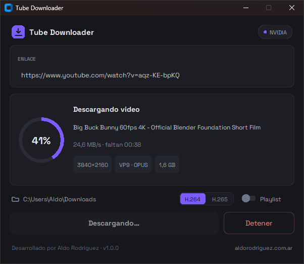
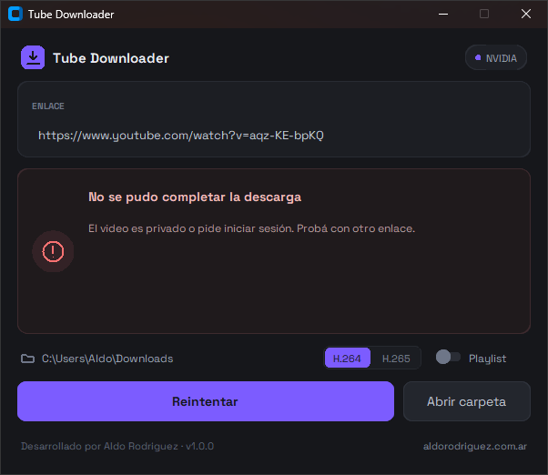
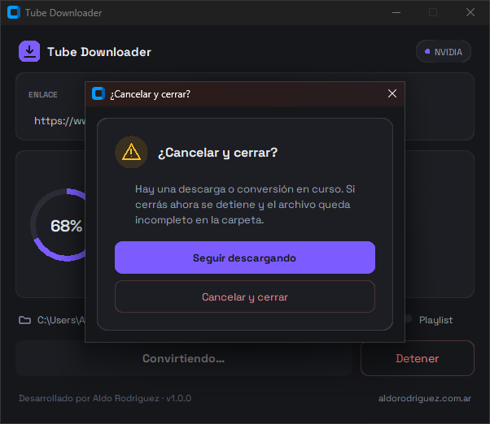
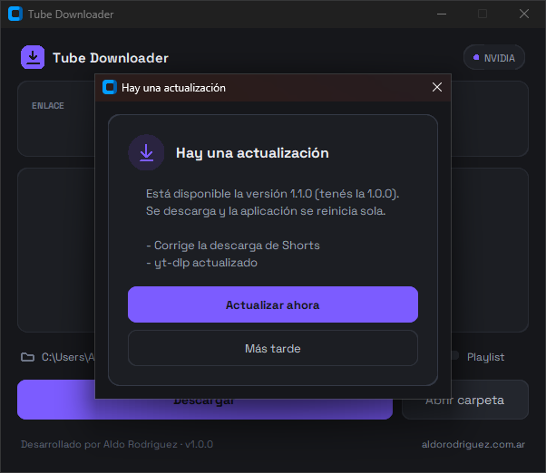
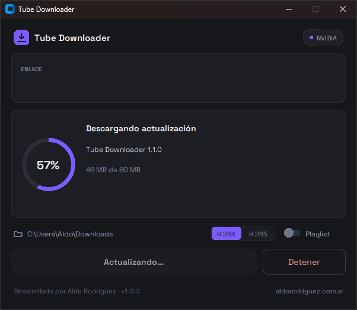

<div align="center">


# Tube Downloader

**Videos de YouTube en la máxima calidad, listos para editar en Premiere Pro.**

🇦🇷 **Español** · [🇬🇧 English](README.en.md)

[](https://github.com/aldomrodriguez/tube-downloader/releases/latest)
[](https://github.com/aldomrodriguez/tube-downloader/releases)
[](#compatibilidad)
[](#compatibilidad)
[](LICENSE)

### [⬇ Descargar TubeDownloader.exe](https://github.com/aldomrodriguez/tube-downloader/releases/latest/download/TubeDownloader.exe)

</div>

---

## Contenido

- [Por qué existe](#por-qué-existe)
- [Qué hace](#qué-hace)
- [Capturas](#capturas)
- [Compatibilidad](#compatibilidad)
- [Instalación y uso](#instalación-y-uso)
- [Actualizaciones](#actualizaciones)
- [Preguntas frecuentes](#preguntas-frecuentes)
- [Compilar desde el código](#compilar-desde-el-código)
- [Cómo funciona](#cómo-funciona)
- [Contribuir](#contribuir)
- [Licencia y créditos](#licencia)

## Por qué existe

Bajar un video en "máxima calidad" y que después no abra en Premiere es un problema
común: YouTube publica sus mejores calidades en VP9 y AV1, códecs que Premiere no
decodifica. La solución típica —bajar directamente lo que ya viene en H.264— tiene
el costo de quedarse en 1080p, porque arriba de esa resolución YouTube ya no ofrece
H.264.

Esta herramienta resuelve las dos cosas a la vez: baja el original real, y lo
convierte a H.264 solo cuando hace falta, usando la placa de video para que no tarde.

## Qué hace

| | |
|---|---|
| 🎯 **Máxima calidad siempre** | Descarga la mejor combinación de video y audio que exista para ese link, incluido 4K. |
| 🎬 **Listo para editar** | El resultado es un MP4 que Premiere Pro abre sin recodificar. |
| ⚡ **No convierte al pedo** | Si YouTube ya ofrece H.264 en la resolución máxima, lo baja así: instantáneo y sin pérdida. |
| 🖥️ **Conversión por placa de video** | NVIDIA, Intel o AMD, con respaldo automático al procesador si la GPU falla. |
| 🎛️ **Elegís el códec** | H.264 (más compatible para editar) o H.265 (archivos ~25% más chicos). |
| 📃 **Playlists** | Un video suelto o la lista completa. |
| 📊 **Progreso real** | Velocidad y tiempo restante, con botón para detener. |
| 📦 **Todo incluido** | Trae ffmpeg adentro; no hay que instalar nada. |
| 🔄 **Se actualiza sola** | Avisa cuando hay una versión nueva y se instala con un clic. |

## Capturas

<table>
  <tr>
    <td align="center" width="50%"><br><sub><b>Inicio</b> · pegás el link y elegís carpeta y códec</sub></td>
    <td align="center" width="50%"><br><sub><b>Descargando</b> · progreso real, velocidad y tiempo restante</sub></td>
  </tr>
  <tr>
    <td align="center"><br><sub><b>Convirtiendo</b> · a H.264 con la placa de video, solo si hace falta</sub></td>
    <td align="center"><br><sub><b>Listo</b> · MP4 que Premiere abre sin recodificar</sub></td>
  </tr>
  <tr>
    <td align="center"><br><sub><b>Errores claros</b> · qué pasó y qué hacer, sin jerga</sub></td>
    <td align="center"><br><sub><b>Cierre seguro</b> · pregunta antes de cortar una descarga</sub></td>
  </tr>
  <tr>
    <td align="center"><br><sub><b>Actualización disponible</b> · con las novedades de la versión</sub></td>
    <td align="center"><br><sub><b>Actualizando</b> · se descarga, se verifica y se reinicia sola</sub></td>
  </tr>
</table>

## Compatibilidad

| Sistema | Estado |
|---|---|
| **Windows 11** (64 bits) | ✅ Compatible |
| **Windows 10** (64 bits) | ✅ Compatible |
| **macOS** | 🔜 Próximamente |

| Aceleración por hardware | Tecnología | Estado |
|---|---|---|
| NVIDIA (GeForce GTX 600 o más nuevas) | NVENC | ✅ |
| Intel (gráficos integrados desde 6.ª generación) | Quick Sync | ✅ |
| AMD (Radeon RX 400 o más nuevas) | AMF | ✅ |
| Sin placa compatible | Procesador | ✅ Más lento, pero funciona igual |

La placa se detecta sola al abrir la aplicación; la que se está usando aparece
arriba a la derecha.

| Editor de video | Estado |
|---|---|
| Adobe Premiere Pro | ✅ Abre el MP4 sin recodificar |
| DaVinci Resolve, Final Cut Pro, CapCut, Vegas | ✅ H.264 + AAC en MP4, el formato más compatible |

## Instalación y uso

Windows 10 u 11 de 64 bits; nada más, el `.exe` es autocontenido y no necesita
instalar ffmpeg ni Python.

1. Descargá [`TubeDownloader.exe`](https://github.com/aldomrodriguez/tube-downloader/releases/latest/download/TubeDownloader.exe)
   y guardalo donde quieras (por ejemplo, el Escritorio). No necesita instalación.
2. Abrilo, pegá el link del video y elegí carpeta y códec.
3. Tocá **Descargar**.

La carpeta de destino y el códec quedan guardados para la próxima vez.

## Actualizaciones

Al abrirse, la aplicación consulta si hay una versión nueva en
[Releases](https://github.com/aldomrodriguez/tube-downloader/releases). Si la hay,
ofrece actualizar: descarga el nuevo `.exe`, verifica que coincida con el publicado
y se reinicia sola ya actualizada.

- Si no hay internet, no pregunta nada y sigue funcionando normal.
- Nunca interrumpe una descarga en curso: espera a que termine.
- Conviene actualizar seguido: YouTube cambia a menudo y cada versión trae un
  yt-dlp al día.

## Preguntas frecuentes

<details>
<summary><b>Windows dice "Windows protegió su PC". ¿Es seguro?</b></summary>

Es el filtro SmartScreen, que avisa con cualquier programa que todavía no descargó
mucha gente. Tocá **Más información → Ejecutar de todas formas**. El código completo
está en este repositorio y podés compilarlo vos mismo.
</details>

<details>
<summary><b>Un video que antes bajaba ahora da error.</b></summary>

Casi siempre es porque YouTube cambió algo. Abrí la aplicación con internet para que
busque la última versión. Si ya estás actualizado y sigue fallando,
[abrí un reporte](https://github.com/aldomrodriguez/tube-downloader/issues/new/choose).
</details>

<details>
<summary><b>¿Por qué a veces tarda y a veces es instantáneo?</b></summary>

Si YouTube ofrece el video en H.264 a su máxima resolución (típicamente hasta 1080p),
se baja tal cual y no hay nada que convertir. En 1440p y 4K YouTube solo ofrece VP9 o
AV1, así que hay que convertir; con placa de video suele llevar una fracción de la
duración del video.
</details>

<details>
<summary><b>¿H.264 o H.265?</b></summary>

H.264 si vas a editar: lo abre cualquier programa y es más liviano para la línea de
tiempo. H.265 si querés archivos más chicos para guardar o compartir.
</details>

<details>
<summary><b>¿Hay versión para Mac?</b></summary>

Todavía no, pero está en camino. Si querés que te avise cuando salga, tocá
**Watch → Custom → Releases** arriba en esta página.
</details>

<details>
<summary><b>¿Dónde guarda la configuración?</b></summary>

En `%APPDATA%\TubeDownloader\config.json`. Borrarlo vuelve todo a los valores por
defecto.
</details>

## Compilar desde el código

Necesitás Python 3.11 o superior.

```powershell
git clone https://github.com/aldomrodriguez/tube-downloader.git
cd tube-downloader
.\build.ps1
```

El script crea el entorno virtual, instala las dependencias, empaqueta todo con
PyInstaller y deja el ejecutable en `dist\TubeDownloader.exe`.

Para correrlo sin empaquetar:

```powershell
python -m venv venv
.\venv\Scripts\python.exe -m pip install -r requirements.txt
.\venv\Scripts\python.exe app.py
```

### Publicar una versión nueva

El proceso completo —número de versión, CHANGELOG, compilación, release y
mantenimiento— está en [RELEASING.md](RELEASING.md).

### Firma de código (opcional)

Si tenés un certificado de firma en tu almacén personal de Windows, `build.ps1` lo
detecta por el nombre del titular y firma el ejecutable automáticamente, con sellado
de tiempo. Si no hay ninguno, la compilación sigue igual y el `.exe` queda sin firmar.

## Cómo funciona

Algunas decisiones que no son obvias y valen la aclaración:

**Elegir formato sin resignar resolución.** Los formatos se ordenan primero por
resolución y recién después por códec, prefiriendo H.264 entre los que empatan. Así
un video que topea en 1080p se baja directamente en H.264 sin convertir nada,
mientras que uno con 4K real baja en 4K y paga la conversión.

**El límite de 4096 píxeles.** El motor H.264 de NVENC no acepta imágenes de más de
4096 px por lado (medido: 4096 codifica, 4097 devuelve "exceeds 4096"). Para videos
más grandes se usa H.265 por GPU, que llega hasta 8192, en vez de caer al procesador.

**Progreso sobre dos archivos.** yt-dlp descarga el video y el audio por separado,
cada uno reportando su propio 0-100%. La aplicación consulta los tamaños antes de
empezar y muestra un único avance sobre el total real, con la velocidad suavizada
para que el tiempo restante no salte.

**Archivo temporal en la conversión.** El archivo descargado suele ser ya un `.mp4`,
así que convertir directamente sobre su mismo nombre haría que ffmpeg intente leer y
escribir el mismo archivo y aborte. La conversión siempre escribe en un temporal que
después reemplaza al original.

**Cierre seguro.** ffmpeg corre como proceso aparte, no como hilo de Python: si se
cierra la ventana sin matarlo queda vivo, bloqueando el archivo a medio escribir. Al
cerrar con trabajo en curso la aplicación pregunta y, si confirmás, lo termina de
verdad.

**Autoactualización.** Windows no deja que un `.exe` en uso se sobrescriba a sí
mismo. La aplicación descarga la versión nueva a una carpeta temporal, verifica su
SHA-256 contra el que publica GitHub y deja un pequeño script que espera a que se
cierre, reemplaza el archivo y la vuelve a abrir. Si el reemplazo falla, queda la
versión anterior intacta.

### Estructura

```
├── app.py              La aplicación (interfaz y lógica de descarga)
├── updater.py          Busca, descarga e instala actualizaciones desde Releases
├── build.ps1           Compila el ejecutable y lo firma si hay certificado
├── requirements.txt    Dependencias de Python
├── version_info.txt    Metadatos del ejecutable (lo completa build.ps1)
├── CHANGELOG.md        Cambios de cada versión (también en inglés: CHANGELOG.en.md)
├── RELEASING.md        Cómo publicar una versión (también en inglés: RELEASING.en.md)
├── assets/             Tipografía Space Grotesk y su licencia
└── docs/               Capturas de pantalla
```

## Contribuir

¡Los aportes son bienvenidos! Antes de empezar, leé la
[guía para contribuir](CONTRIBUTING.md) y el [código de conducta](CODE_OF_CONDUCT.md).

- 🐛 ¿Encontraste un error? [Reportalo](https://github.com/aldomrodriguez/tube-downloader/issues/new?template=reporte-de-error.yml).
- 💡 ¿Tenés una idea? [Proponela](https://github.com/aldomrodriguez/tube-downloader/issues/new?template=sugerencia.yml).
- 🔒 ¿Encontraste un problema de seguridad? Seguí la [política de seguridad](SECURITY.md); no lo publiques en un issue.

Podés escribir issues y pull requests en español o en inglés. La documentación completa está también [en inglés](README.en.md).

## Licencia

[GPL-3.0](LICENSE).

El ejecutable incluye una compilación de FFmpeg hecha con `--enable-gpl
--enable-version3`, así que el binario distribuido queda cubierto por la GPL versión
3. Por eso el proyecto adopta esa misma licencia.

## Créditos

- [yt-dlp](https://github.com/yt-dlp/yt-dlp) — motor de descarga
- [FFmpeg](https://ffmpeg.org/) — decodificación, conversión y mezcla
- [CustomTkinter](https://github.com/TomSchimansky/CustomTkinter) — widgets de la interfaz
- [Space Grotesk](https://fonts.google.com/specimen/Space+Grotesk) de Florian Karsten,
  bajo [SIL Open Font License](assets/SpaceGrotesk-OFL.txt)

## Uso responsable

Esta herramienta está pensada para descargar contenido propio, material con licencia
que lo permita, o videos cuyos derechos te autoricen a hacerlo. Descargar material con
derechos de autor sin permiso puede violar los términos de servicio de YouTube y la
legislación de tu país. El uso que le des es tu responsabilidad.

---

<div align="center">

Desarrollado por **Aldo Rodriguez** — [aldorodriguez.com.ar](https://aldorodriguez.com.ar)

</div>
